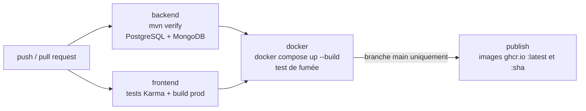

# Déploiement — EducManager

> [Benjamin – #08, 2026-10-15] Création.

## 1. Environnements

| Environnement | Lancement | Bases | Usage |
|---|---|---|---|
| Développement | `start-educmanager.bat` ou `mvnw spring-boot:run` + `npm start` | H2 en mémoire (+ MongoDB facultatif) | Codage au quotidien |
| Intégration (CI) | GitHub Actions à chaque push / pull request | PostgreSQL 16 + MongoDB 7 (services GitHub) | Vérification automatique |
| Production / démo | `docker compose up -d --build` | PostgreSQL 16 + MongoDB 7 (conteneurs, volumes persistants) | Serveur ou poste avec Docker |

## 2. Prérequis serveur

- Docker 24+ et Docker Compose v2 (Docker Desktop sous Windows).
- Ports : 8081 (application) — modifiable avec `APP_PORT`.
- Pour un serveur public : un reverse proxy HTTPS devant le port 8081 (Caddy, Traefik ou nginx + Let's Encrypt).

## 3. Procédure de déploiement

```bash
git clone https://github.com/<compte>/EducManager.git
cd EducManager
cp .env.example .env          # puis éditer .env : mots de passe et JWT_SECRET
# générer un secret : openssl rand -base64 48
docker compose up -d --build  # construit les images, démarre les 4 conteneurs
docker compose ps             # tous les services doivent être "healthy"
bash scripts/smoke-test.sh    # vérification de bout en bout (sous Windows : Git Bash)
```

Application : http://localhost:8081 — avec `APP_SEED_ENABLED=true`, les comptes de démonstration sont créés au premier démarrage
(à passer à `false` et à remplacer par de vrais comptes pour une vraie production).

## 4. Variables d'environnement

| Variable | Obligatoire | Rôle |
|---|---|---|
| `DB_PASSWORD` | oui | Mot de passe PostgreSQL |
| `MONGO_PASSWORD` | oui | Mot de passe MongoDB |
| `JWT_SECRET` | oui | Secret de signature des tokens (≥ 32 caractères) |
| `DB_USER`, `MONGO_USER` | non | Utilisateurs (défaut `educmanager`) |
| `APP_SEED_ENABLED` | non | Données de démonstration si base vide |
| `APP_PORT` | non | Port publié (défaut 8081) |
| `CORS_ORIGINS` | non | Origines autorisées (défaut `http://localhost:8081`) |
| `JWT_EXPIRATION_MS`, `LOGIN_MAX_ATTEMPTS`, `LOGIN_BLOCK_MINUTES`, `AUDIT_RETENTION_DAYS`, `SWAGGER_ENABLED` | non | Réglages fins (voir `application.properties`) |

Le fichier `.env` contient des secrets : il est exclu de Git (`.gitignore`).

## 5. Chaîne CI/CD (GitHub Actions — `.github/workflows/ci.yml`)



- Une étape en échec bloque les suivantes : une image n'est publiée que si **tous** les tests passent.
- Les images publiées sont étiquetées avec l'empreinte du commit (`:sha`) : on sait exactement quelle version tourne.

## 6. Exploitation

| Action | Commande |
|---|---|
| Voir l'état | `docker compose ps` |
| Logs du backend | `docker compose logs -f backend` |
| Mettre à jour | `git pull && docker compose up -d --build` |
| Revenir à une version (rollback) | `git checkout <tag-ou-commit> && docker compose up -d --build` (ou `IMAGE_TAG=<sha>` avec les images ghcr) |
| Sauvegarder PostgreSQL | `docker compose exec postgres pg_dump -U educmanager educmanager > sauvegarde.sql` |
| Restaurer PostgreSQL | `docker compose exec -T postgres psql -U educmanager educmanager < sauvegarde.sql` |
| Sauvegarder MongoDB | `docker compose exec mongo mongodump -u educmanager -p <mdp> --authenticationDatabase admin --archive > audit.archive` |
| Arrêter (sans perdre les données) | `docker compose down` |
| Tout supprimer, données comprises | `docker compose down -v` |

Supervision : `GET /api/health` sur le backend (vérifie la connexion PostgreSQL ; utilisé par le healthcheck Docker).
