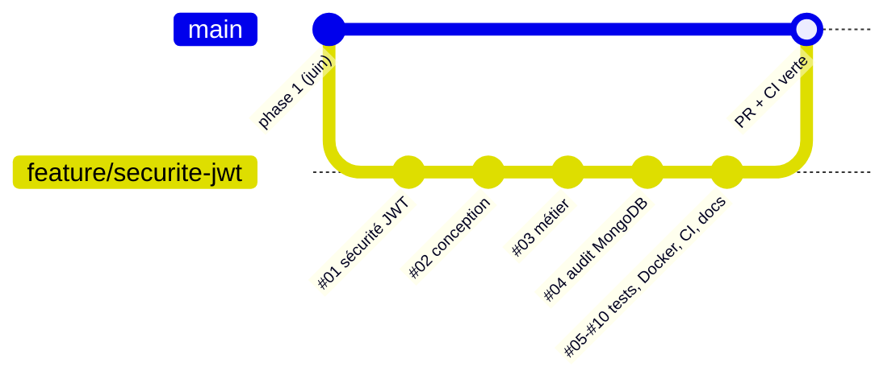

# Gestion de projet — EducManager

> [Benjamin – #10, 2026-10-15] Création.

## 1. Organisation

| Élément | Choix |
|---|---|
| Méthode | Agile inspirée de Scrum : itérations courtes, backlog priorisé, revue à la fin de chaque lot |
| Équipe | Cyprien, Manar, Benjamin (phase 1, juin 2026) ; Benjamin (phase 2, octobre 2026) — voir [QUI-FAIT-QUOI.md](QUI-FAIT-QUOI.md) |
| Outils | GitHub (code, pull requests, Actions), GitHub Projects (tableau Kanban), IntelliJ / VS Code |
| Suivi | Tableau Kanban : *À faire → En cours → En revue → Terminé* ; une carte par user story ou tâche technique |
| Traçabilité | Une branche par lot (`feature/...`), commits conventionnels (`feat:`, `fix:`, `docs:`, `test:`, `ci:`), journal des lots (`JOURNAL_DEV.md`) |
| Qualité | Une pull request ne peut être fusionnée que si la CI est verte (tests + build + Docker) |

## 2. Workflow Git

## 3. Backlog (phase 2)

Le fichier [`backlog.csv`](backlog.csv) peut être importé dans GitHub Projects ou un tableur.

| Lot | Contenu | Priorité | Estimation | Statut |
|---|---|---|---|---|
| #00 | Environnement local | Haute | 0,5 j | ✅ |
| #01 | Sécurité JWT de bout en bout (US01, US02) | Haute | 1 j | ✅ |
| #02 | Conception : cahier des charges, maquettes, MCD/MLD, architecture | Haute | 1 j | ✅ |
| #03 | Métier : cours CRUD, promotions, inscriptions, comptes, planning (US03–US08, US10) | Haute | 3 j | ✅ |
| #04 | Journal d'audit MongoDB (US09) | Moyenne | 1 j | ✅ |
| #05 | Durcissement sécurité (OWASP, jjwt 0.12, anti force brute, profils, H2 console) | Haute | 1 j | ✅ |
| #06 | Tests backend (unitaires + intégration H2/PostgreSQL) + plan de tests | Haute | 1,5 j | ✅ |
| #07 | Pages Angular (cours, promotions, inscriptions, utilisateurs, audit, planning, tableau de bord) | Haute | 2 j | ✅ |
| #08 | Docker, docker compose, nginx, CI/CD GitHub Actions, documentation de déploiement | Haute | 1,5 j | ✅ |
| #09 | Tests frontend (Karma) | Moyenne | 0,5 j | ✅ |
| #10 | Documentation de gestion de projet | Basse | 0,5 j | ✅ |

## 4. Rituels proposés pour la suite

- **Planification** (début d'itération) : choisir les cartes du backlog, les découper en tâches < 1 jour.
- **Point quotidien** (10 min) : fait hier / prévu aujourd'hui / blocages.
- **Revue** (fin d'itération) : démonstration sur l'environnement Docker, mise à jour du journal et de QUI-FAIT-QUOI.
- **Rétrospective** : ce qui a marché, ce qu'on améliore.

## 5. Mise en place du tableau GitHub Projects (à faire une fois)

1. Sur GitHub : *Projects* → *New project* → modèle **Board**.
2. Colonnes : À faire, En cours, En revue, Terminé.
3. Créer une carte par ligne de `backlog.csv` (ou *Import* depuis un tableur) et lier chaque pull request à sa carte.
