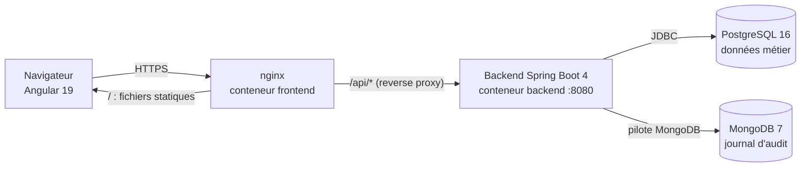
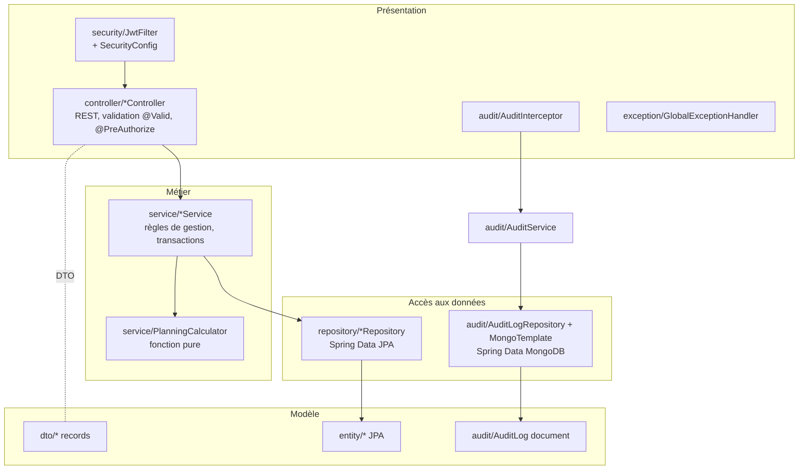

# Architecture logicielle — EducManager

> [Benjamin – #02, 2026-10-15] Création : documentation de l'architecture existante et des ajouts de la phase 2.

## 1. Vue d'ensemble (déploiement)

- Le navigateur ne parle qu'à **nginx** (même origine : pas de CORS, cookies et tokens non exposés à un autre domaine).
- Le backend n'est **pas** publié sur l'hôte : il n'est joignable que depuis le réseau Docker interne.
- Les deux bases ont des volumes Docker persistants.

## 2. Architecture en couches du backend

| Couche | Paquet | Responsabilité | Règle |
|---|---|---|---|
| Présentation | `controller`, `security`, `exception`, `audit.AuditController` | Recevoir les requêtes HTTP, vérifier l'authentification / les droits, valider les données, traduire les erreurs en codes HTTP | Pas de logique métier, pas d'accès direct aux repositories (sauf lectures simples historiques) |
| Métier | `service` | Règles de gestion, transactions (`@Transactional`) | Ne connaît pas HTTP ; lève des exceptions métier (`ConflictException`, `BadRequestException`...) |
| Accès aux données | `repository`, `audit.AuditLogRepository` | Requêtes SQL (JPQL / méthodes dérivées) et MongoDB | Aucune règle métier |
| Modèle | `entity`, `dto`, `mapper` | Entités persistées, objets échangés avec le front | Les entités ne sortent de l'API que pour les objets simples (Course) ; sinon DTO |

**Transverse :** `config` (données de démonstration, horloge injectable, async, intercepteurs).

## 3. Architecture du frontend Angular

| Dossier | Contenu |
|---|---|
| `core/auth` | `AuthService` (session, token), `authInterceptor` (ajout du token, gestion du 401), guards (`auth`, `guest`, `role`, `default-route`) |
| `features/<domaine>` | Une page par domaine (`pages/`) + son service HTTP (`services/`) : filières, cursus, cours, promotions, inscriptions, utilisateurs, audit, calendrier, dashboard |
| `shared` | Layout (sidebar), configuration de navigation par rôle, modèles TypeScript (miroirs des DTO Java), utilitaire `apiErrorMessage` |

Le front masque les actions non autorisées (ergonomie), mais **la sécurité est assurée par le backend** : chaque route est re-vérifiée côté serveur.

## 4. Choix techniques et justifications

| Choix | Pourquoi |
|---|---|
| API REST + JWT sans état | Front et back découplés ; pas de session serveur à partager ; standard |
| Relecture du compte en base à chaque requête (`JwtFilter`) | Un compte supprimé ou un rôle modifié prend effet immédiatement (le token seul ne suffit pas) |
| DTO en `record` Java | Immuables, concis, validation par annotations |
| PostgreSQL pour le métier | Données fortement liées, contraintes d'intégrité (clés étrangères, unicité) |
| MongoDB pour l'audit | Voir [MODELE_DE_DONNEES.md](MODELE_DE_DONNEES.md) §4 |
| Audit par intercepteur + `@Async` | Aucun code d'audit dans les contrôleurs ; aucune requête ralentie ; l'appli fonctionne même sans MongoDB |
| `Clock` injectée | Tests déterministes des dates (inscriptions, blocage du login) |
| H2 en développement, PostgreSQL en production (profils Spring) | Démarrage local sans installation ; même code, configuration différente |
| nginx devant Angular | Sert les fichiers statiques, relaie l'API, ajoute les en-têtes de sécurité |
