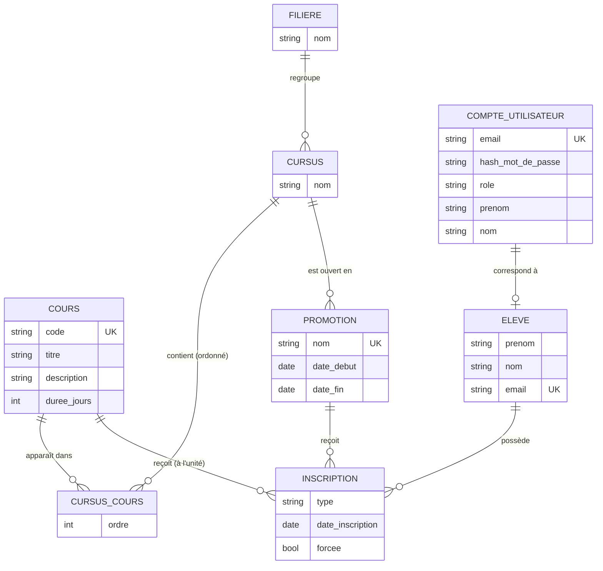

# Modèle de données — EducManager

> [Benjamin – #02, 2026-10-15] Création. Le schéma physique réel est dans [`schema-postgresql.sql`](schema-postgresql.sql)
> (extrait par `pg_dump` de la base PostgreSQL créée par l'application).

## 1. MCD (modèle conceptuel)



**Cardinalités clés**
- Une filière regroupe 0..n cursus ; un cursus appartient à exactement 1 filière.
- Un cursus contient 0..n cours dans un **ordre** donné ; un cours peut figurer dans plusieurs cursus (association porteuse `CURSUS_COURS`).
- Une promotion est une session datée d'**un** cursus.
- Une inscription relie 1 élève à **soit** 1 promotion (type `PROMOTION`), **soit** 1 cours (type `UNIT`).
- Un compte de rôle `STUDENT` correspond à exactement une fiche élève.

## 2. MLD (modèle logique relationnel)

- **filiere** (<u>id</u>, name)
- **cursus** (<u>id</u>, name, #filiere_id)
- **courses** (<u>id</u>, code UNIQUE, titre, description, duree_jours CHECK 1–200)
- **cursus_courses** (<u>id</u>, #cursus_id, #course_id, ordre) — UNIQUE (cursus_id, ordre), UNIQUE (cursus_id, course_id)
- **promotion** (<u>id</u>, name UNIQUE, start_date, end_date, #cursus_id)
- **user_account** (<u>id</u>, username UNIQUE, password_hash, role CHECK, first_name, last_name)
- **student** (<u>id</u>, first_name, last_name, email UNIQUE, #user_account_id UNIQUE)
- **enrollment** (<u>id</u>, #student_id, type CHECK, #promotion_id NULL, #course_id NULL, enrollment_date, forced) — UNIQUE (student_id, promotion_id), UNIQUE (student_id, course_id)

## 3. Règles de gestion

| Règle | Où elle est garantie |
|---|---|
| Code de cours unique (insensible à la casse, stocké en majuscules) | `CourseService` + contrainte UNIQUE |
| Une inscription PROMOTION a une promotion et pas de cours ; UNIT l'inverse | `EnrollmentService` |
| Pas de double inscription | `EnrollmentService` (409) + contraintes UNIQUE |
| Promotion terminée : inscription seulement si `forced` | `EnrollmentService` |
| Date de fin de promotion ≥ date de début | `PromotionService` + contrôle Angular |
| Pas de suppression d'un cours / d'une promotion / d'un élève encore utilisé | Services (409) + clés étrangères (409 via `GlobalExceptionHandler`) |
| Email de compte unique, mot de passe haché BCrypt | `UserService` + contrainte UNIQUE |

## 4. Choix de la base NoSQL (MongoDB) pour le journal d'audit

Le journal d'audit n'a **pas** sa place dans PostgreSQL :
- ce sont des événements indépendants, écrits très souvent et jamais modifiés ;
- leur structure peut évoluer (nouveaux champs) sans migration de schéma ;
- aucune jointure avec le modèle métier n'est nécessaire ;
- MongoDB supprime automatiquement les documents expirés grâce à un **index TTL** (conservation limitée pour le RGPD).

Document de la collection `audit_logs` :

```json
{
  "_id": "6710f1c2a3...",
  "timestamp": "2026-10-15T10:00:00Z",
  "username": "referente@educmanager.fr",
  "action": "CREATE",
  "resource": "promotions",
  "resourceId": null,
  "httpMethod": "POST",
  "path": "/api/promotions",
  "status": 201,
  "ipAddress": "172.18.0.1"
}
```

Index : `ttl_timestamp` (TTL de 365 jours, paramètre `app.audit.retention-days`) et `idx_username`.
Accès aux données : `AuditLogRepository` (Spring Data `MongoRepository`) et `MongoTemplate` pour la recherche multicritère paginée (`AuditService`).
